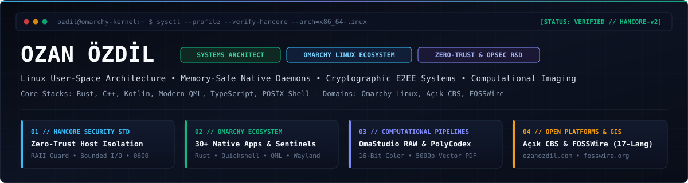
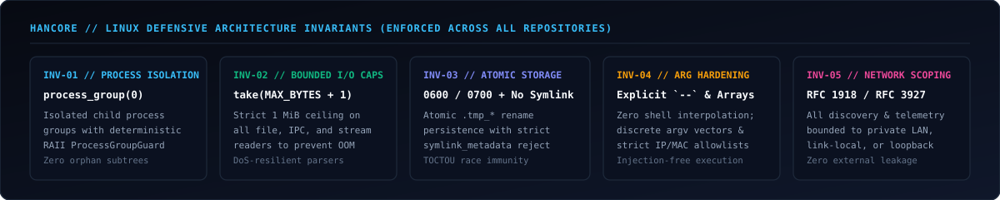

 

---

### Engineering Profile & Architectural Focus

Independent systems architect and software engineer specializing in Linux user-space engineering, zero-trust host security sentinels, cryptographic data sovereignty, and high-performance desktop infrastructure. Creator of the **HANCORE Defensive Architecture Standard**, core contributor to the **Omarchy Linux** ecosystem, founder of **FOSSWire** (published across 17 languages), and lead architect of **Açık CBS** (`acikcbs.com`).

- **Defensive Systems & Host Security (`HANCORE`)**: Designing kernel-adjacent monitoring daemons, deterministic process group supervisors (`process_group(0)` with RAII `ProcessGroupGuard`), BadUSB hardware transaction guards, honey-token ransomware tripwires, and DNS/MAC privacy shields.
- **Concurrent & Memory-Safe Runtimes**: Building zero-allocation hot paths, bounded-memory I/O parsers (`take(MAX + 1)`), atomic state engines (`0600`/`0700` `.tmp_*` persistence with `symlink_metadata` rejection), and cryptographic E2EE storage in Rust and C++.
- **Declarative Desktop & Cross-Device Frameworks**: Constructing low-latency Wayland/Hyprland shell components, native Quickshell/QML desktop suites, L2CAP Bluetooth audio DSP studios, and encrypted Linux-to-Android/Web local network bridges.
- **Computational Imaging & Spatial Systems**: Engineering 16-bit non-destructive RAW photographic laboratories, 5,000-page layout-preserving document translation pipelines, and sovereign spatial data platforms.

  

---

### Core Engineering & Open-Source Ecosystem

#### 01 // Host Security, Privacy & Network Sentinels (HANCORE Compliant)

| Repository | Architectural Scope & Engineering Highlights | Core Stack |
| :--- | :--- | :--- |
| **[omarchy-security-sentinel](https://github.com/ozdil/omarchy-security-sentinel)** | Unified cyber defense suite consolidating BadUSB hardware guard, kernel integrity auditor, honey-token tripwire vault, CVE/DoT/MAC/SSH sentinels, OpSec scrubber, and SHA-256 self-verification | `Rust` `sysfs` `udev` `Inotify` |
| **[omarchy-omablock](https://github.com/ozdil/omarchy-omablock)** | Zero-latency system-wide adblocker, DNS/hosts privacy shield, and native OmaBlock Shield Bridge for Chromium | `Rust` `DNS` `Netfilter` |
| **[omarchy-netradar](https://github.com/ozdil/omarchy-netradar)** | Zero-trust RFC 1918/3927 local network scanner, ARP/ICMP device radar, latency monitor, and hardened SSH/Web service launcher | `QML` `IPC` `Networking` |
| **[osint](https://github.com/ozdil/osint)** | High-performance, resource-centric passive Open-Source Intelligence (OSINT) reconnaissance platform | `Rust` `Async I/O` `Security` |

#### 02 // High-Performance Native Applications & Cross-Platform Bridges

| Repository | Architectural Scope & Engineering Highlights | Core Stack |
| :--- | :--- | :--- |
| **[omarchy-omastudio](https://github.com/ozdil/omarchy-omastudio)** | Lightroom-grade 16-bit non-destructive RAW photo laboratory with DaVinci color grading, AI scene presets, and Google Drive cloud sync | `Rust` `QML` `GPU Pipeline` |
| **[polycodex](https://github.com/ozdil/polycodex)** | Universal 1:1 layout-preserving and vector-preserving 5,000-page PDF document translation engine | `Rust` `Multithreading` `PDF` |
| **[omarchy-omasend](https://github.com/ozdil/omarchy-omasend)** | Wireless AirBridge, QR pairing, zero-copy hybrid image clipboard sync, and high-speed LAN file transfer daemon | `Rust` `Zero-Copy I/O` `TLS` |
| **[omasend-android](https://github.com/ozdil/omasend-android)** / **[omasend-web](https://github.com/ozdil/omasend-web)** | Native Android (Kotlin) and Progressive Web App (TypeScript) Zero-Knowledge E2EE companions for OmaSend AirBridge | `Kotlin` `TypeScript` `E2EE` |
| **[omarchy-omanotes](https://github.com/ozdil/omarchy-omanotes)** | Zero-Knowledge E2EE Google Keep alternative with Argon2id v2 KDF, authenticated encryption, checklists, and cloud sync | `Rust` `Argon2id` `AEAD` |
| **[omarchy-omarank](https://github.com/ozdil/omarchy-omarank)** / **[omastat](https://github.com/ozdil/omastat)** | Synthetic CPU/GPU benchmark suite, hardware telemetry profiler, and privacy-preserving community survey engine | `Rust` `HTML` `Telemetry` |
| **[omarchy-plugins](https://github.com/ozdil/omarchy-plugins)** | Hardware-level Apple Beats & AirPods audio studio, L2CAP AAP daemon, ANC/Transparency control, tri-battery telemetry, and PipeWire DSP equalizer | `Rust` `Bluetooth L2CAP` `DSP` |
| **[deckopt](https://github.com/ozdil/deckopt)** | Valve Steam Deck autonomous game telemetry profiler and AI-driven thermal/performance optimizer | `Python` `Linux APU` `SteamOS` |

#### 03 // Desktop Shell, Developer Tooling & Information Feeds

| Repository | Architectural Scope & Engineering Highlights | Core Stack |
| :--- | :--- | :--- |
| **[omarchy-fosswire](https://github.com/ozdil/omarchy-fosswire)** | Native Omarchy top-bar news dispatch plugin delivering FOSSWire open-source journalism across all 17 `fosswire.org` languages | `QML` `Quickshell` `i18n` |
| **[omarchy-omacom-news](https://github.com/ozdil/omarchy-omacom-news)** | Official Omarchy news dispatches, distro release tracker, category filters, and in-app ReaderModal with AI synthesis | `QML` `Quickshell` `REST` |
| **[quicknews](https://github.com/ozdil/quicknews)** | Text-first, ad-free, HANCORE-hardened native news reader with automated RSS/Atom feed discovery | `Rust` `Quickshell` `XML` |
| **[omarchy-omarss](https://github.com/ozdil/omarchy-omarss)** | High-performance native RSS/Atom feed reader, background feed monitor, and desktop article notification center | `QML` `Quickshell` `Atom` |
| **[omarchy-plugin-craft](https://github.com/ozdil/omarchy-plugin-craft)** | Unified plugin lifecycle manager, centralized launcher hub, bar layout organizer, and dashboard detector for Omarchy Linux | `QML` `Desktop IPC` `Wayland` |
| **[omarchy-git-radar](https://github.com/ozdil/omarchy-git-radar)** | Developer activity pulse, multi-repository status monitor, live git commit tracker, and Wayland clipboard integration | `QML` `Git` `Wayland` |

#### 04 // Display Engineering & OLED Theme Systems

| Repository | Visual Architecture & Target Display Profile | Target Environment |
| :--- | :--- | :--- |
| **[omarchy-monotone-theme](https://github.com/ozdil/omarchy-monotone-theme)** | Official high-contrast Monotone theme paired with a 60 FPS multi-arcade retro screensaver engine | `Omarchy` `Python` `Wayland` |
| **[omarchy-neuramancer-theme](https://github.com/ozdil/omarchy-neuramancer-theme)** | Cyberpunk P1 CRT phosphor-green terminal aesthetic with 20 custom 8K dot-to-dot vector wallpapers | `Omarchy` `Aether` `Hyprland` |
| **[omarchy-steammachine-theme](https://github.com/ozdil/omarchy-steammachine-theme)** | Steam Machine Edition theme featuring precision Valve, Steam Deck, Half-Life, and Aperture Science vector art | `Omarchy 4.0+` `Hyprland` |
| **[omarchy-turkiye-theme](https://github.com/ozdil/omarchy-turkiye-theme)** | Eye-friendly, true-black OLED theme celebrating 21 iconic landmarks of Türkiye in sharp vector art | `Omarchy 4.0+` `OLED` |
| **[omarchy-istanbul-theme](https://github.com/ozdil/omarchy-istanbul-theme)** | OLED-optimized dark theme inspired by traditional Iznik ceramics, Turkish motifs, and Bosphorus nights | `Omarchy 4.0+` `OLED` |
| **[omarchy-ankara-theme](https://github.com/ozdil/omarchy-ankara-theme)** | OLED-optimized dark theme featuring Hittite Sun, Kuğulu Park, and modernist Ankara vector geometry | `Omarchy 4.0+` `OLED` |

---

### Open-Source Sustainability & GitHub Sponsors

  

All tools in the **Omarchy Security & Application Suite**, **Açık CBS (`acikcbs.com`)**, and **FOSSWire (`fosswire.org`)** are engineered independently with **zero telemetry, zero advertisements, and permissive open-source licensing**. Sponsorships directly fund dedicated bare-metal Linux test hardware, multi-architecture CI/CD pipelines, cryptographic verification, and public spatial/media infrastructure.

| Sponsorship Tier | Monthly | Focus & Impact Allocation |
| :--- | :--- | :--- |
| **Open-Source Backer** | `$5 / mo` | Fuels continuous maintenance, Arch/Omarchy package builds, and public documentation |
| **Systems Supporter** | `$15 / mo` | Supports HANCORE security sentinels, CVE rule feeds, and cross-device E2EE bridges |
| **Security & Kernel Sentinel** | `$50 / mo` | Funds bare-metal USB/Wi-Fi/Bluetooth hardware testing and priority issue triage |
| **Architecture Patron** | `$100 / mo` | Accelerates R&D on OmaStudio 16-bit RAW, PolyCodex, and Açık CBS vector tile infrastructure |
| **Enterprise & Ecosystem Partner** | `$250 / mo` | Dedicated architectural advisory, roadmap prioritization, and README/release recognition |

> **Direct Sponsorship Portal**: **[github.com/sponsors/ozdil](https://github.com/sponsors/ozdil)** • Full bilingual sponsorship specification: **[SPONSORS.md](./SPONSORS.md)**

---

### Technical Competencies & Environment Matrix

- **Systems & Core Languages**: `Rust` • `C++` • `Kotlin` • `TypeScript` • `Modern QML` • `Python` • `POSIX Shell / Bash`
- **Linux Kernel & User-Space**: Arch & Omarchy Linux, Linux IPC, D-Bus, `sysfs`, `procfs`, `udev`, `inotify`, `systemd`, Netlink, PipeWire DSP, Bluetooth L2CAP
- **HANCORE Security Engineering**: `process_group(0)` RAII `ProcessGroupGuard`, bounded `take(MAX + 1)` stream caps, `0600`/`0700` atomic `.tmp_*` persistence, `symlink_metadata` rejection, Argon2id + AEAD cryptography, RFC 1918/3927 network scoping
- **UI & Cross-Platform Frameworks**: Quickshell, Qt6 / QML, Wayland / Hyprland, Android SDK / Jetpack Compose, Progressive Web Apps (PWA), Astro, Svelte
- **Typography & Interface Standard**: Strict `JetBrainsMono Nerd Font, JetBrains Mono, monospace` fallback chain across all desktop surfaces and bar plugins

---

### Dynamic Development Telemetry

  
  

  

**[ozanozdil.com](https://ozanozdil.com)** • **[github.com/sponsors/ozdil](https://github.com/sponsors/ozdil)** • **[fosswire.org](https://fosswire.org)** • **[acikcbs.com](https://acikcbs.com)**

